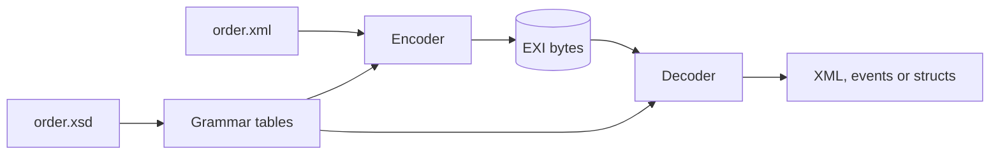

# Welcome

This guide shows you how to turn XML into EXI and back from Julia, one small
example at a time.

**EXI** (Efficient XML Interchange) is a W3C standard for sending XML as
compact binary. The order in this guide's examples is 538 bytes of XML and only
129 bytes of EXI.

The trick is that both sides share the XML [schema](glossary.md#schema). Each
side knows which elements and attributes can come next, and what type each
value has. So the stream does not have to spell out names or write numbers as
text.

New to EXI? [Words you'll see](glossary.md) explains the terms in one or two
lines each.

## What you will learn

Each chapter follows one small script in `examples/basics`, from easiest to
hardest:

1. **Round trip**: XML to EXI and back in three calls.
2. **Options**: what the header holds, and what changes the size.
3. **Reading events**: walking a stream one piece at a time.
4. **Writing events**: building a document without any XML text.
5. **Structs**: turning your own Julia types into EXI.
6. **Prebuilt tables**: skipping the schema step when your program runs.

Every example has a Rust twin in rexi that prints exactly the same output, so you
can read the two languages side by side.

## What JExi does not do (yet)

JExi works in [strict](glossary.md#strict-non-strict), schema-informed mode
only. That is the most compact form EXI offers. Compression, schema-less
streams, non-strict mode and the "preserve" options (comments, prefixes and so
on) are refused with a clear error. JExi never quietly does something close
enough instead.
