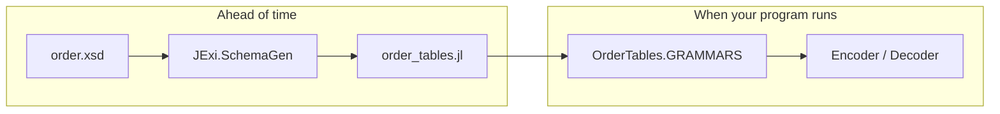

# Prebuilt tables

In this chapter you'll compile the schema ahead of time and save the tables as
Julia code, so your program starts fast.

Up to now, every script read and compiled `order.xsd` when it started. You can
do that work once and save the
[grammar tables](glossary.md#grammar-grammar-tables):

```julia
import JExi
JExi.SchemaGen.generate(["examples/basics/data/order.xsd"];
    out = "examples/basics/order_tables.jl", module_name = "OrderTables")
```



The result is a module with a constant `GRAMMARS`. Use it anywhere you used
compiled tables:

```julia
{{#include ../../examples/basics/prebuilt_tables.jl:main}}
```

```text
EXI: 129 bytes
same bytes with compiled and prebuilt tables: true
decoded with prebuilt tables: <Order xmlns="urn:rexi:interop:order" orderId="ORD-2026-0007" priority="true">...
```

## Why bother?

- **No start-up cost.** Include the file in your package and the tables are
  [precompiled](glossary.md#precompile) with it.
- **No XSD files to ship.** The schema is built into your code.
- **Fast names.** The module also has a constant for every name, such as
  `OrderTables.LN_ORDER`. `JExi.start_element!(enc, OrderTables.LN_ORDER)` skips
  the name lookup.

In your tests, pass `check = true` to `generate`. It returns `false` if the
file no longer matches the schema.
