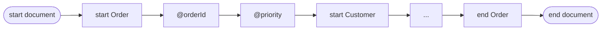

# Reading events

In this chapter you'll read a stream one piece at a time and get typed values,
not text.

`decode_to_xml` is handy, but sometimes you want the data, not the text. The
**pull decoder** hands you one [event](glossary.md#event) at a time: the start
of an element, an attribute, some content, or the end of an element.



A `Decoder` is an iterator, so a `for` loop walks the whole document. Each event
is a small struct (`StartElement`, `Attribute`, `Characters`, ...), so you can
check its kind with `isa`:

```julia
{{#include ../../examples/basics/read_events.jl:main}}
```

Output (shortened):

```text
start document
Order
  @orderId = ORD-2026-0007 (string)
  @priority = true (boolean)
  Customer
    ...
  Item
    @sku = BK-001 (string)
    Quantity
      2 (integer)
    Price
      42.95 (decimal)
  ...
end document
```

## What to notice

- **Values are typed.** `priority` arrives as a `Bool` and `Quantity` as an
  integer. You don't have to parse text, because the schema already said what
  each one is.
- **Events are yours to keep.** Each event is a plain value. You can push it
  into a vector or pass it to `JExi.Encoder` later.
- **`next_event!` works too.** To pull events one by one yourself, call
  `JExi.next_event!(dec)`. It gives the next event, or `nothing` at the end.
