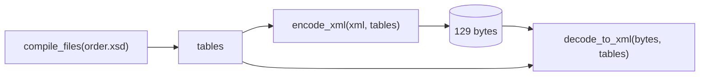

# Your first round trip

In this chapter you'll turn XML text into EXI bytes and back again. It takes
three steps:



```julia
{{#include ../../examples/basics/roundtrip.jl:main}}
```

Output:

```text
XML: 538 bytes
EXI: 129 bytes
  80 07 a7 a9 22 16 99 18 19 1b 16 98 18 18 1b a0
  ...
decoded XML:
<Order xmlns="urn:rexi:interop:order" orderId="ORD-2026-0007" priority="true">...
```

## What to notice

- **Compile the schema once.** `compile_files` makes the
  [grammar tables](glossary.md#grammar-grammar-tables). It is the slowest step,
  so keep the tables and reuse them for every document.
- **The decoder needs the same options.** Here the
  [options](glossary.md#options) are not written into the stream (that keeps
  it small), so `decode_to_xml` is told them. The next chapter shows the other
  way.
- **Values come back in standard form.** The price `31.50` comes back as
  `31.5`, because EXI stores the number, not the text you typed. The line
  breaks between elements are dropped too. The schema says those elements hold
  only other elements, not text.
