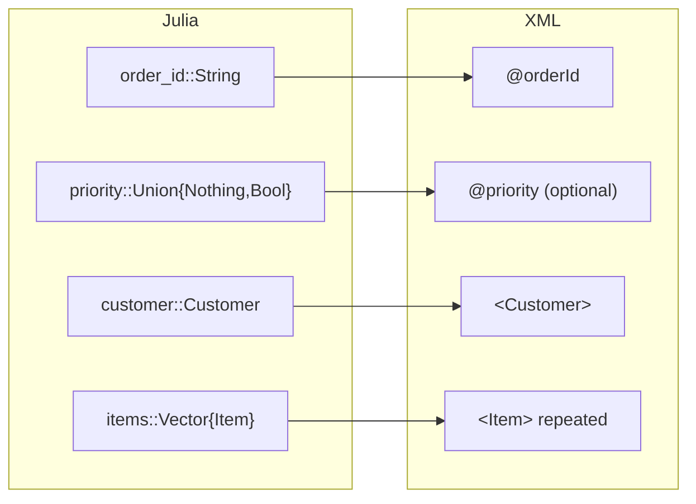

# Julia structs

In this chapter you'll describe a document once as Julia structs, then encode
and decode it with one call each.

Writing events by hand gets long. `JExi.to_exi` and `JExi.from_exi` do the
walking for you:

```julia
{{#include ../../examples/basics/structs.jl:types}}
```

The [schema](glossary.md#schema) decides where each field goes, so you never
mark a field as an attribute or an element yourself:



| Julia | XML |
|---|---|
| `Union{Nothing,T}` | An item that may be missing |
| `Vector{T}` | An item that repeats |
| `JExi.exi_names(::Type{T})`, `JExi.exi_rename_all` | Match Julia names to XML names |
| `@enum` | An `xs:enumeration` value |
| A `Union` of structs, or `JExi.exi_choices` | A choice between elements |

The full list of rules is at the top of `src/structs/structs.jl`. Encoding and
decoding are then one call each:

```julia
{{#include ../../examples/basics/structs.jl:main}}
```

```text
EXI: 129 bytes
same bytes as encoding order.xml: true
decodes and encodes to the same bytes: true
order ORD-2026-0007 for Raven Bookstore (gold)
  2 x Distributed Systems Patterns     42.95
  1 x Practical EXI                    31.50
  total 117.40
  notes: gift-wrap requested
```

The bytes are the same as encoding the XML file. EXI does not care how you made
the events, only what they are.
