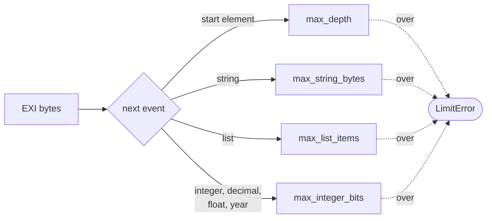

# Untrusted input

In this chapter you'll see how JExi guards against hostile streams and schemas,
and how to loosen a guard when you trust the source.

EXI is tiny on the wire, so a dozen bytes can ask for a huge amount of work:
"a list of four billion items", or "this element holds itself, forever". So the
decoder has four **limits**. They are on by default, far above what a normal
document needs. Going over one stops decoding with a `LimitError` such as
`decoder limit exceeded: nesting depth is over 256`.

| Limit | Default | What it stops |
|---|---|---|
| `max_depth` | 256 | Elements nested too deeply. A schema where an element must hold itself lets 2 bytes nest without end, and deep trees overflow the stack in `from_exi`. |
| `max_list_items` | 1,000,000 | Too many items in one list. Items can take zero bits, so a short stream can claim any count. |
| `max_integer_bits` | 4096 | Huge integers (also in decimals, floats and years), which are slow to read. |
| `max_string_bytes` | 256 MiB | Too much text in total. A repeat from the [string table](glossary.md#string-table) costs a few bits, so one long string repeated can grow into gigabytes. |

Each check happens *before* the work it guards:



## Changing a limit

If you trust the source, pass `limits` to `Decoder`, `decode_events`,
`decode_to_xml` or `from_exi`. `nothing` turns one limit off, and
`JExi.unlimited_limits()` turns all four off (use that only for input you made
yourself):

```julia
limits = JExi.DecodeLimits(max_depth = 1000, max_string_bytes = nothing)
xml = JExi.decode_to_xml(bytes, tables; options, limits)
```

`bin/jexi decode`, `dump-events` and `bench decode` take `--max-depth N`,
`--max-list-items N`, `--max-integer-bits N`, `--max-string-bytes N` (0 means
no limit) and `--no-limits`. The encoder has no limits: its input comes from
your own program.

## Untrusted schemas

`xs:include` and `xs:import` could name any file your program can read, such as
`../../../etc/passwd`, `/dev/zero` or a named pipe. So schema loading has rules
too, on by default:

- Included files must sit under the main schema's folder (for `compile_string`,
  its `base_dir`; with none, it may not include anything). This is checked
  before any file is touched, so an error never tells whether a file exists.
  Symbolic links that lead outside are refused too.
- Only regular files, at most 16 MiB each. No URLs, pipes or devices.
- One type's content may grow to at most 100,000 grammar rules
  (`max_grammar_size`). A `maxOccurs` of 10,000 makes about 20,000; tidying a
  grammar is also capped at 100 productions per allowed rule, so
  `maxOccurs="20000"` is refused. Going over gives "schema too large".
- A group that contains itself is a "circular group reference". A loop through
  a global element or a named type is fine.

Breaking a rule throws a `SchemaError` that says "refused", such as
`schema location '../common/types.xsd' refused: outside the main schema's folder (set a schema root to allow it)`.
For a trusted set that reaches outside its folder, like UBL's `../common/...`,
set the root (`:anywhere` allows any local file), or raise the size cap:

```julia
opts = JExi.SchemaLoadOptions(; root = "ubl", max_grammar_size = 1_000_000)
tables = JExi.compile_files("ubl/maindoc/Order.xsd"; load_options = opts)
```

`compile_string` takes the same `load_options`. On the command line, every command that takes `--xsd` also takes
`--schema-root DIR`.
