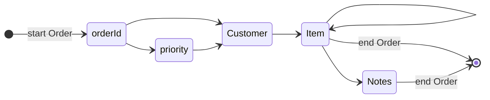

# Writing events

In this chapter you'll build an EXI document straight from your program's data,
with no XML text at all.

The encoder works like the decoder in reverse: you call one function per
[event](glossary.md#event).

```julia
{{#include ../../examples/basics/write_events.jl:main}}
```

```text
EXI: 129 bytes
same bytes as encoding order.xml: true
```

## The encoder follows the schema

The [grammar](glossary.md#grammar-grammar-tables) works like a map of what may
come next. After `start Order`, the encoder expects `@orderId`, then perhaps
`@priority`, then a `Customer`, and so on:



If you call something out of order, such as `Item` before `Customer`, the
encoder throws a `GrammarError` that says what it expected. Two rules trip
people up:

- **Attributes come first, sorted by name.**
  [Strict](glossary.md#strict-non-strict) EXI wants them in the schema's sorted
  order, before any child elements.
- **Unqualified attributes have no namespace.** This schema puts elements in
  `urn:rexi:interop:order`, but attributes use `""`.

## Three ways to pass a value

| Value | Meaning |
|---|---|
| `"gold"` | Text. A string field stores it as it is. Other types parse it, like text from an XML file. |
| `true`, `2` | A typed value, used as it is. |
| `JExi.Lexical("42.95")` | [Text](glossary.md#text-lexical-value) that JExi always parses with the schema's type. |

`Lexical` makes it clear you mean "parse this". Typed values skip the parsing.
